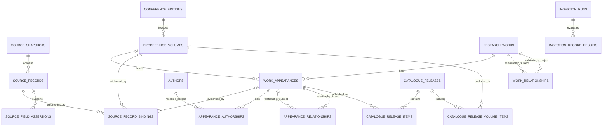

# ADR-0001 — CHI Catalogue Identity, Appearances and Provenance

- **Product:** Litervia — Discover research. Explore knowledge.
- **Issue:** [#13 — CHI normalization, identity and provenance pilot](https://github.com/PetrosTam/litervia/issues/13)
- **Draft date:** 2026-10-31
- **Status:** **APPROVED ARCHITECTURAL BASELINE**, with the explicit **PROPOSED** refinements and **OPEN** decisions below. **NOT an approval to create migrations or ingest data.**
- **Scope:** CHI 1982–2026 research catalogue and its controlled data lifecycle; private user data is addressed solely as a boundary.
- **Companions:** [CHI Normalization Contract](../research/chi-normalization-contract.md) (draft implementation contract) · [Metadata Publication & Rights Policy](../research/chi-metadata-publication-rights-policy.md) (**PUB-01–PUB-06 APPROVED**).
- **Review boundary (updated 2026-11-01):** Documentation-only [PR #14](https://github.com/PetrosTam/litervia/pull/14) was squash-merged as `4b6b681`; this ADR remains the approved architectural baseline, **not** an authorization for research ingestion, database migrations or Issue #13 closure. The AC-09 source-evidence reconciliation is a separately reviewed local-first documentation update.

## 1. Decision context and source hierarchy

**APPROVED product facts:** The catalogue covers CHI 1982–2026. Ordinary app/API traffic must not mutate research metadata; user notes, favourites, collections, reading state and preferences belong in a separately secured private database. Original DBLP research snapshots remain immutable outside Git. The owner explicitly approved (a) the separation of `research_works`, `work_appearances`, and `source_records` as the architectural baseline, and (b) the discovery policy: main CHI proceedings appear by default; Extended Abstracts, Companion and workshops/co-located materials are accessible through distinct filters; unknown/unverified material is accessible under All/Unclassified but is not automatically included in main results. **Main volume does not imply Technical Paper.**

**VERIFIED implementation baseline:** The connected GitHub repository describes Laravel 13, React (JavaScript), and PostgreSQL 18 with separate `litervia_catalogue` and `litervia_private` databases; the application uses a separate catalogue database connection. PostgreSQL Issue #11 created roles and test foundations, **not** research tables, runtime grants, or ingestion. Its README continues to describe the Research page as a placeholder. Existing runtime catalogue grants are not yet a proof of SELECT-only permissions on future tables. See [PostgreSQL foundation](https://github.com/PetrosTam/litervia/blob/main/docs/postgresql-foundation.md).

**VERIFIED source/pilot observations:** The dated DBLP XML snapshot `2026-10-03` (archive SHA-256 `20e45961bec5610dc07b8e932ccd27a2387534cfa12c92a24289fe873aebe969`) yielded 28,870 CHI-labelled source records: 28,775 `inproceedings` and 95 `proceedings`. The complete scan reported 12,998,506 top-level records; the older historical audit reported 13,022,717. Their matching selected-row aggregate does **not** prove snapshot-by-snapshot equality. The independently inspected pilot CSV has SHA-256 `34360f4b1470213cf5f9c52b5bba9179bc07b1fb6b7fbcff860a087`, 150 unique DBLP keys, 134 `inproceedings`, 16 `proceedings` volumes, 10 records across five historical collision candidates, 21 `inproceedings` without a recognized DOI URL in `<ee>`, one multi-DOI record, and three authorless `inproceedings`. The pilot is deliberately exception-enriched; **its frequencies are not population estimates**.

**Authoritative project references:** `Litervia_Product_Engineering_Specification.pdf` §§5.1–6.4, 8, 12; `Litervia_Master_Project_Instructions.txt`, Stage 02; `Litervia_Software_Engineering_Master_Playbook.pdf`; the CHI record-level audit, yearly coverage and title-collision evidence; live Issue #13. Where older supporting documents say SQLite, PostgreSQL 18 supersedes that proposal by the approved and verified Issue #11 foundation. The source-only zero for 1984 does not establish a universal historical absence of research output.

## 2. Decision (approved principles)

**A1 — Three independent identities (APPROVED).**

1. `research_works` represent Litervia's stable, internal canonical research-work references; they are not publisher, DOI, DBLP or historical dataset IDs.
2. `work_appearances` represent specific bibliographic publications/appearances, including different volumes, lengths, tracks or versions; they may share a reviewed work relationship without losing their independent metadata.
3. `source_records` preserve the observed record from a named source snapshot. Multiple snapshots may corroborate the same appearance but remain separate source records.
4. `proceedings` volume records are **not** research papers. They are linked to `proceedings_volumes` and are excluded from paper/work counts by type.
5. `conference_editions`, `proceedings_volumes`, bibliographic appearances, **source category**, and evidence-based **contribution type** remain distinct concepts.

**A2 — No inference by superficial similarity (APPROVED).** Matching normalized title/year, display author name, venue name, or partial DOI is insufficient to merge records, people or appearances. Preserve the DBLP key, original author order, complete source fields, DOI candidates, and record-level provenance. Identity conflicts require explicit review; the 141 historical title/year collision groups are *candidates*, not confirmed duplicates.

**A3 — Stable references and private boundaries (APPROVED).** Public canonical IDs must not change merely because enrichment or classification changes. Private user records point to stable canonical IDs, never an upstream DOI/key. PostgreSQL's two separate databases do not provide a normal cross-database foreign key; Laravel server-side referential checks and controlled redirects are required. No ordinary public request can write research metadata. No private owner authorization is delegated to the client.

**A4 — Evidence-gated discovery (APPROVED).** Main CHI category is selected by default; the other approved categories remain queryable. An unreviewed `booktitle` heuristic cannot make a record a main paper, and `main` cannot make its `contribution_type` `technical_paper`. Absence of evidence must be represented honestly.

**A5 — Source/rights integrity (APPROVED).** Original input artifacts remain outside Git; derived catalogue data is managed by approved, auditable import processes. Field-level lineage, rights and unknown states must be retained. DBLP bibliographic metadata CC0 does **not** grant rights to publisher abstracts, images, PDF text, recordings, or other third-party content.

## 3. Entity relationship model (logical; table definitions not frozen)

Notes: `SOURCE_RECORD_BINDINGS` has a **typed, exclusive target**: exactly one of `appearance_id` and `volume_id`. A source record may have **multiple historical binding decisions**, but at most **one active binding** per source observation; an unresolved/quarantined record may have none. This is a **PROPOSED physical simplification** of the approved appearance/volume source-link concept. Both subject and object ends of the relationship tables must have enforceable typed FKs, with no self-relation or prohibited cycles. `CATALOGUE_RELEASE_VOLUME_ITEMS` is a proposed logical release-membership relation, not necessarily a separate physical table. Each immutable release must also pin the selected field assertions, authorship presentation and classification/identity decision versions used in public responses; the precise implementation (release-scoped mapping vs immutable revision manifest) remains OPEN. Additional logical entities (typed identifiers, author-affiliation evidence, classification/identity decisions, redirects) are specified in the companion contract. Workshop events may require an explicitly evidenced `colocated_with` event relationship rather than misclassifying their volumes as main CHI.

### Ownership and key boundaries

| Domain | Logical entity / responsibility | Proposed invariant |
|---|---|---|
| Source | `source_snapshots`, `source_records` | Unique `(source_snapshot_id, source_record_key)`; same key in different snapshots allowed; checksummed source identity |
| Venue | `conference_editions`, `proceedings_volumes` | Only substantiated editions/volumes; volumes are not countable research works |
| Identity | `research_works`, `work_appearances` | Separate immutable Litervia IDs; each appearance belongs to exactly one current work; no title/year uniqueness |
| Source mapping | `source_record_bindings` | Exactly one typed target **per binding**; zero or one **active** binding per source record, with historical decisions retained; no silent rebinding |
| Authorship | `authors`, `appearance_authorships` | Ordered source names always preserved; canonical person nullable; unique `(appearance_id, position, source_context)` as appropriate |
| Identifiers | `external_identifiers` | Scheme-scoped normalization; entity-specific FK ownership enforced, not free-form polymorphism; original value preserved |
| Provenance | `source_field_assertions`, `classification_decisions`, `identity_decisions` | Competing claims preserved; selected facts attributable, reversible and reviewable |
| Relationships | `appearance_relationships`, `work_relationships`, `work_redirects` | Typed relations with evidence; no inferred equivalence; redirects acyclic and permanent |
| Publication | `ingestion_runs`, `ingestion_record_results`, `catalogue_releases`, `catalogue_release_items`, proposed `catalogue_release_volume_items` | Stage is invisible; release membership covers **both** appearances and source-backed volumes, and pins selected display assertions; previous release remains reproducible |

The exact count of tables, FK names, generated UUID method, selected-field caching, join structure, and constraints beyond these principles are **PROPOSED** until physical design approval.

## 4. Considered alternatives and consequences

| Alternative | Decision | Rationale |
|---|---|---|
| Single `papers` table, unique by DOI/title/year | **Rejected** | Loses proceedings, versions, collisions and source disagreements; gives false canonical IDs. |
| Source-key-only display, no canonical layer | **Rejected** | Private notes/collections and stable public URLs cannot safely follow raw upstream key changes and multiple sources. |
| Separate `research_works` / `work_appearances` / `source_records` | **Approved** | Represents all five collision candidates without conflation. |
| Implement full IFLA LRM or RDF knowledge graph | **Not adopted** | Conceptually useful but disproportionate to present Laravel/PostgreSQL scope. |
| Automatically merge a shared DOI or shared title | **Rejected as default** | DOI is an identifier claim, sometimes volume- or version-level; ambiguous authors and track variants need review. |
| Catalogue and private data in one runtime DB | **Rejected** | Contrary to the approved PostgreSQL separation and least-privilege design. |
| Versioned, manually promotable catalogue release | **PROPOSED** | Prevents partially validated imports being exposed; precise release snapshot mechanism to benchmark. |

**Benefits:** provenance, auditability, stable private references, truthful category counts, and safe future enrichment. **Costs:** more joins, review operations, identity/redirect governance, and clear staging/release semantics. **Mitigation:** defer optional enrichment tables and optimize only on measured queries.

## 5. Classification and discovery semantics

- Distinguish `record_kind = proceedings_volume | bibliographic_appearance` from `source_category = main_chi | extended_abstracts | companion_adjunct | workshop_colocated | unknown_unverified`.
- Independently maintain `contribution_type` (`technical_paper`, `poster`, `demo_interactivity`, `video_showcase`, `course`, `case_study`, `other_verified`, `unknown` as a proposed starting vocabulary). **Never derive contribution type solely from booktitle, DOI prefix, page count or volume membership.**
- Only independently evidenced volume linkage may set the verified source category of an appearance. `workshop_colocated` must not be treated as part of the main CHI research-track count.
- Default discovery is explicitly `source_category = main_chi` **with verified membership**; EA, Companion and Workshop are separately opt-in. `All/Unclassified` allows inspection of unresolved records. Source volumes are not results in work discovery.
- If multiple qualifying appearances point to the same reviewed work, work-level results deduplicate **after category filtering**, choose a deterministic representative appearance and expose the others on detail pages. The underlying source/appearance counts remain distinct from work counts. The final SQL/API search/collation contract is still OPEN.

## 6. Identity decision policy

- Initial mapping is **conservative**: one appearance per distinct `inproceedings` source key unless evidence supports otherwise. One provisional work per appearance is the proposed first-import state, not a claim of 28,775 distinct conceptual scholarly works.
- A same-key record in a new snapshot may map to an existing appearance only after checking record kind, venue/volume, identifiers and material conflicting metadata; conflicts go into review rather than silent overwrite.
- `candidate_related`, `same_work_confirmed`, `distinct_works_confirmed`, `rejected_match`, `superseded` are **PROPOSED decision outcomes**, not yet data values or implemented tables. Use source citations, reviewer, timestamp, reasoning and reversal links for each adjudication.
- A confirmed work consolidation must not delete a referenced historical ID: preserve immutable aliases/redirects and ensure resolution is acyclic. Cross-database private data migration is a separate authorization gate.
- The relation vocabulary should describe real evidence: `related_version`, `supersedes`, `supplement`, `same_contribution_candidate`, `different_contributions`, `unknown_relation`. DataCite relation terms are an inspiration; do **not** apply `IsIdenticalTo` or `IsNewVersionOf` without verification.

## 7. Lifecycle, transaction and permission boundaries

**PROPOSED pipeline:** immutable source and hashes -> validated staging -> deterministic source-record mapping -> reviewed category/identifier/identity assertions -> count and rights reconciliation -> candidate release -> explicit approval/promotion -> read-only public catalogue. Failed or incomplete runs are never visible. Reprocessing the *same* snapshot must preserve existing IDs and the previous published release. A snapshot update is a versioned source change, not a destructive UPSERT. A release must freeze its appearance **and volume** membership and the exact selected assertion/decision revisions used for public display; otherwise rollback could return different results after metadata enrichment. Rollback should move the active pointer to the previous verified release, retaining the audit trail; no cross-database atomicity is assumed.

**EXISTING connection reality:** Laravel's default `private` and explicit `catalogue` PostgreSQL connections are configured in the repository. The catalogue runtime role must receive only SELECT on approved **published** tables/views, not staging or raw/private evidence tables, with no CREATE/INSERT/UPDATE/DELETE. A view-based boundary is not secure solely because a view exists: review its owner, base-relation grants, function execution rights, `security_invoker`/`security_barrier` implications, and any row-level policies against actual PostgreSQL 18 semantics. Ingestion must operate via a separately authorized restricted writer identity; never use the HTTP runtime identity or migrator credentials. The migration principal must be independently authorized and used only during reviewed migrations. These are grant requirements, **not currently verified post-migration ACLs**.

## 8. Decision register

| ID | State | Decision / unresolved question | Closure evidence or impact |
|---|---|---|---|
| D-01 | **APPROVED** | Separate work, appearance, source record identities | Owner approval in conversation; Specification §6.3 |
| D-02 | **APPROVED** | Main-only default; EA/Companion/Workshop separately discoverable; unknown visible through All | Owner approval in conversation |
| D-03 | **APPROVED** | Stable IDs, raw source preservation, no title/year merge, two databases | Specification §§5–6; owner approval; Issue #11 |
| D-04 | **PROPOSED** | UUID strategy, typed XOR source bindings and single typed identifier table | PostgreSQL constraint design and migrations review |
| D-05 | **PROPOSED** | Stage/publish release pointer, release-scoped appearance/volume memberships and pinned display-assertion revisions, controlled promotion/rollback | Transaction/recovery design and test fixtures |
| D-06 | **OPEN** | How to decide same-work vs related/different appearances for TC-001/002/071/140/141 | Record-level official sources, reviewer reasoning and evidence log |
| D-07 | **OPEN** | DOI canonicalization and ambiguous multi-DOI policy, DOI resolver checks | Scheme test cases, official DOI metadata/targets, collisions |
| D-08 | **OPEN** | Verified main/EA/workshop volume crosswalk and exact track/contribution vocabulary | Official publisher/workshop evidence, including AutomationXP discrepancy |
| D-09 | **APPROVED POLICY / OPEN IMPLEMENTATION** | PUB-01–PUB-06 define conservative publication, DBLP title fallback, attribution and asset-clearance gates; source-specific Crossref/OpenAlex/ACM integration and individual content rights remain OPEN | [Approved publication policy](../research/chi-metadata-publication-rights-policy.md), provider terms and per-asset verification |
| D-10 | **OPEN** | PostgreSQL collation, multilingual search, performance and API query contract | Approved filters plus fixture benchmarks, EXPLAIN, negative API tests |
| D-11 | **OPEN** | Identity review authority, redirect resolution policy, private-reference migration | Owner decision, authorization and consistency tests |
| D-12 | **OPEN** | Final physical table count, read-view security grants and importer role privileges | Reviewed migrations and isolated PostgreSQL privilege tests |
| D-13 | **OPEN** | 1984 display/historical interpretation and independently corroborated coverage | Preserve source zero; do not invent historical conference claims |
| D-14 | **OPEN** | Completion of mandatory official-source cross-checks on seven pilot years and all disputed pairs | At least 2 cited records/year, collision case review, conflict resolution |

## 9. Evidence and limitations

The pilot demonstrates a **need** for separation, not the correctness of a final populated schema. There is no implemented Laravel importer, complete publisher corpus comparison, proven title/author/DOI reconciliation, rights clearance for media/full text, or database ingestion. A valid DOI-shaped URL is not proof that a DOI resolves. Historical zero entries in 1984 describe a source export; they do not prove universal historical absence.

**Example disputes:** `TC-071` has main and EA appearances with different author lists; `TC-141` has two different Extended Abstracts DOI; `AutomationXP@CHI 2023` has **20 `inproceedings` plus one `proceedings` volume record** in the pilot, while the CEUR Volume 3394 index reports 19 accepted short papers. The mismatch is a source-reconciliation case, **not** permission to delete the extra record or infer it was not published. **Owner-approved handling (2026-10-31):** `short10.pdf` TOC membership remains OPEN/DISPUTED but an editorial answer is not a prerequisite for unrelated, independently verified records.

## 10. Acceptance gate and next action

**Verification state:** Uploaded pilot evidence was statically inspected; document checks are distinct from implementation validation. Laravel importer tests, PostgreSQL schema/permission tests and runtime search tests are **NOT RUN**.

**PR #14 — documentation gate COMPLETED:** This ADR and its three companion documents were reviewed and merged in [PR #14](https://github.com/PetrosTam/litervia/pull/14), squash commit `4b6b681`; local `main` was synchronized and the old feature branch removed. The fourteen-case [source evidence index](../research/chi-source-evidence-identity-review.md#6-seven-year-comparison-register-14-cases) retains publisher/track/rights limits. A **new, separately authorized documentation-only AC-09 update** adds dated corroboration and an explicit open-decision register, without treating PR #14 CI as research importer test coverage.

**Issue #13 / future implementation gate (2026-11-01):** Owner accepted AC-01–AC-08 after verified source/pilot checks and bounded documentation reviews; AC-09 evidence reconciliation and AC-10 implementation authorization remain **OPEN** until separate acceptance. Current evidence is recorded in the [AC-09 review](../research/chi-source-evidence-identity-review.md#8-ac-09--final-evidence-reconciliation-and-open-decision-register-2026-11-01). Five same-work relations, exact DOI canonicalization, contribution taxonomy, source/asset rights, physical PostgreSQL constraints/permissions and the public API/search contract remain independent gates. Importer, rollback, grants and runtime tests are **NOT RUN**; no migration, ingestion or deployment is authorized.

## 11. External references (reviewed 2026-10-31)

1. [DBLP licence and CC0](https://dblp.org/db/about/copyright.html), [DBLP XML](https://dblp.org/xml/).
2. [W3C PROV-O](https://www.w3.org/TR/prov-o/) — source, transformation and actor lineage.
3. [DataCite version relationship guidance](https://support.datacite.org/docs/versioning) — typed, evidence-sensitive relations.
4. [OpenAlex authorships model](https://help.openalex.org/data/authorships/) — original names/affiliations separate from resolved identities.
5. [PostgreSQL 18 constraints](https://www.postgresql.org/docs/18/ddl-constraints.html), [INSERT / ON CONFLICT](https://www.postgresql.org/docs/18/sql-insert.html), [view permissions and security](https://www.postgresql.org/docs/18/sql-createview.html).
6. [CEUR Volume 3394](https://ceur-ws.org/Vol-3394/) — AutomationXP workshop source index.
7. [OpenCitations Meta code](https://github.com/opencitations/oc_meta) — a reviewed *reference implementation*, not a dependency proposal.
